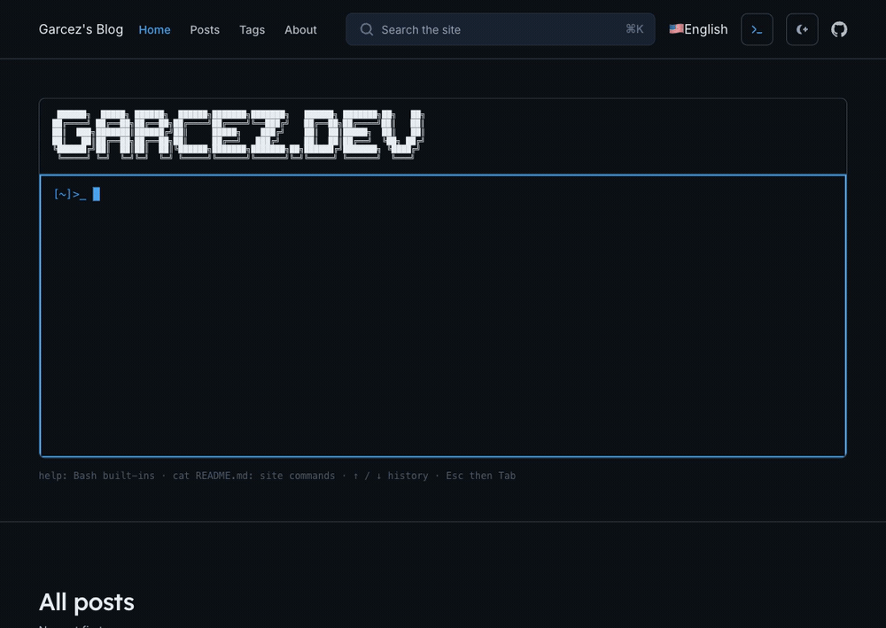
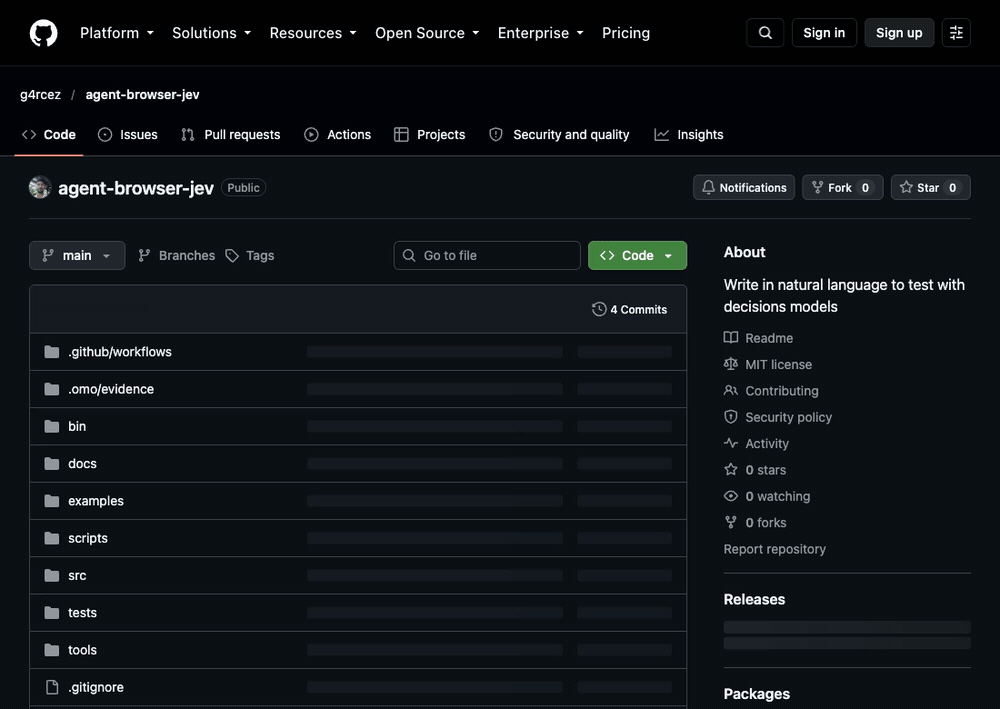

# agent-browser Jev/Laya tests

Create browser tests in **YAML or JSON** from a prompt and ordered instructions. **agent-browser controls the browser; Jev or Laya chooses the next action.** User-authored assertions determine whether a test passes.

This is the 0.2.0 release candidate. Supported execution targets are ordinary HTML/ARIA controls and open shadow roots on Chromium. Release evidence and remaining external gates are recorded in [release readiness](docs/RELEASE-READINESS.md).

## Install from source

Requires Bun 1.3.14+, agent-browser, and Chrome. The browser controller is a peer dependency.

```sh
bun install
bun run build
bunx agent-browser install
./bin/jev-test --help
```

The packaged entry points are `jev-test` and `agent-browser-plugin-jev`. Package smoke tests install the tarball into a separate project and exercise both entry points through a real browser. This repository is prepared for publication; registry and repository ownership must be configured before publishing.

## Try `ls` in a visible browser

This example opens [garcez.dev](https://garcez.dev/), types `ls` in its interactive terminal, presses Enter, and checks the complete output listing:

```text
README.md
agents.ts
posts
projects
skills.ts
tags
```



Start the local Laya service in one terminal:

```sh
uv run tools/laya-server.py
```

In another terminal, run the example with a visible Chrome window:

```sh
bun run demo:garcez
```

The helper waits for the terminal prompt, runs the real CLI, writes JSON/JUnit reports and a screenshot under `artifacts/garcez-ls-SESSION/`, and leaves the browser open for inspection. It prints the session name and a command to close it. The GIF above was recorded from a real successful Laya run; decisions are not scripted.

To run the test definition directly, validate it and enable agent-browser's headed mode:

```sh
./bin/jev-test validate examples/garcez-ls.yaml
AGENT_BROWSER_HEADED=true ./bin/jev-test run examples/garcez-ls.yaml \
  --backend laya --session garcez-ls --report-dir artifacts/garcez-ls
```

To use Jev with your configured `TYPESAFE_API_KEY`:

```sh
bun run demo:garcez -- --backend jev
```

To record a new GIF, install `ffmpeg` on your PATH, then run:

```sh
bun run demo:garcez -- --record
```

Recording captures real frames through agent-browser screenshots, saves those frames and a video with the run artifacts, and regenerates `docs/assets/garcez-ls.gif`. This avoids native screencast distortion on headed browsers with an emulated viewport. The assertion checks the contiguous output sequence, so the site's help text mentioning individual filenames cannot pass the test by itself.

## Try GitHub's Star control

Laya opens [this repository](https://github.com/g4rcez/agent-browser-jev), chooses **Star**, and reaches GitHub's sign-in page in a signed-out browser:



With the local Laya service running:

```sh
bun run demo:github
bun run demo:github -- --record
```

This recording uses [`examples/github-star-sign-in.yaml`](examples/github-star-sign-in.yaml). It checks both the exact sign-in URL and the visible username field. **It does not add a star or treat the sign-in page as a successful star.** No credentials are entered or recorded. Real-run receipts are in [GitHub evidence](docs/evidence/github-star-sign-in.json) and [terminal evidence](docs/evidence/garcez-ls.json).

To actually star the repository, open a named browser session, sign in manually, then run the separate authenticated definition:

```sh
agent-browser --session github-star --headed open https://github.com/g4rcez/agent-browser-jev
# Sign in manually in that browser before continuing.
./bin/jev-test run examples/github-star.yaml --session github-star \
  --report-dir artifacts/github-star
```

**This changes your GitHub account.** The definition requires a visible **Unstar this repository** button as proof. If that state is already present, the step assertion advances without clicking it. It does not intentionally toggle the star off. This authenticated variant is schema-validated but has not been live-verified; it needs a signed-in browser and GitHub's current markup. Use a test account and inspect the result. Close the session when finished with `agent-browser --session github-star close`.

## Write a test

YAML (`.yaml` or `.yml`, case-insensitive) and JSON use the same fields, validation, CLI overrides, limits, and reports. Files with other extensions retain JSON parsing. YAML uses Bun's built-in parser; no YAML package is required. Quote strings such as `"true"` or `"123"` when you need text rather than YAML booleans or numbers. YAML is data only: it does not interpolate environment variables; use `valueFromEnv` for secret field values.

```yaml
name: Find Casa Flora
url: http://localhost:3000
prompt: Find a stay in Lisbon with Design and free cancellation, then open Casa Flora.
backend:
  provider: laya
steps:
  - instruction: Enter Lisbon in Destination
    value: Lisbon
    expect:
      selector: '[name=destination]'
      value: Lisbon
  - instruction: Choose Design in Category
    expect:
      selector: '[name=category]'
      value: Design
  - instruction: Enable free cancellation
    expect:
      selector: '[name=cancellation]'
      checked: true
  - instruction: Submit Find stays
    expect:
      text: 1 matching stay
  - Open Casa Flora
expect:
  - text: 'Applied filters: Lisbon / Design / cancellation enabled'
```

<details>
<summary>JSON format is still supported</summary>

```json
{
  "name": "Find a stay",
  "url": "http://localhost:3000",
  "prompt": "Search Lisbon, select Design and free cancellation, and open Casa Flora.",
  "backend": { "provider": "laya" },
  "steps": [
    {
      "instruction": "Enter Lisbon in Destination",
      "value": "Lisbon",
      "expect": { "selector": "[name=destination]", "value": "Lisbon" }
    },
    {
      "instruction": "Choose Design in Category",
      "expect": { "selector": "[name=category]", "value": "Design" }
    },
    {
      "instruction": "Enable free cancellation",
      "expect": { "selector": "[name=cancellation]", "checked": true }
    },
    {
      "instruction": "Submit Find stays",
      "expect": { "text": "1 matching stay" }
    },
    "Open Casa Flora"
  ],
  "expect": [
    { "text": "Applied filters: Lisbon / Design / cancellation enabled" }
  ]
}
```

</details>

Use your app's URL, controls, and expected outcomes. Save the definition as `stay.test.yaml` (or `.yml` / `.json`), then run:

```sh
./bin/jev-test validate stay.test.yaml
./bin/jev-test run stay.test.yaml --report-dir artifacts/results
```

### Example definitions

| Workflow | Definition | Prerequisite / result |
| --- | --- | --- |
| Terminal command | [YAML](examples/garcez-ls.yaml) · [JSON](examples/garcez-ls.json) | Public garcez.dev; checks all six `ls` entries in order |
| GitHub Star sign-in gate | [YAML](examples/github-star-sign-in.yaml) | Signed-out browser; checks sign-in, not a star |
| GitHub star | [YAML](examples/github-star.yaml) | Manually signed-in session; changes account state; not live-verified |
| Form, select, checkbox, details | [YAML](examples/stay-search.yaml) · [JSON](examples/stay-search.json) | Your compatible local stay-search app at port 3000 |

The CLI automatically continues paused calls. It emits JSON and JUnit reports and returns exit code **0 only for a passed test**, 1 for failed/blocked/uncertain, 2 for invalid input, and 130 for cancellation. Total-test time includes browser startup, inference, input, and assertions.

The prompt and full step list are preserved in the request's task context. Each decision question focuses on the current instruction. Satisfied step assertions advance without another model call; known-unsatisfied assertions withhold DONE. Inputs still come from the selected decision backend. Root `expect` assertions, or an explicit final step expectation, are required. DONE alone cannot pass a test.

## Assertions

An assertion can combine `text` and an exact `url`, or use a test-authored CSS `selector` with `visible`, `value`, `checked`, or `count`. Element value/checked checks require exactly one match. A selector by itself requires one match. `visible: false` and `count: 0` can assert absence. Read-only assertion waits observe DOM/input/history events, bounded by `timeoutMs` (default 2000, maximum 10000).

Assertions query the main document; they do not pierce shadow roots. Choose an outcome that distinguishes the final screen from a matching label on an earlier screen.

## Decision backends

| Provider | Endpoint                                         | Credential environment                     |
| -------- | ------------------------------------------------ | ------------------------------------------ |
| Jev      | `TYPESAFE_BASE_URL` or `https://api.typesafe.ai` | `TYPESAFE_API_KEY`                         |
| Laya     | `LAYA_BASE_URL` or `http://127.0.0.1:8791`       | `LAYA_API_KEY` when the server requires it |

Both use POST `/v1/systemone`. Override `backend.baseUrl`, `backend.model`, or `backend.apiKeyEnv` in a definition, or choose `--backend jev|laya` on the CLI. Jev defaults to `jev-latest`; pin a model when reproducibility matters. There is no automatic backend switch.

An optional local service pins the browser-tuned Laya checkpoint and inference format:

```sh
uv run tools/laya-server.py
bun run test:live -- --backend laya
```

It binds to loopback and loads `cklxx/laya-browser@645cf366a2ae35f1086e8c20eff48f909bb49206`. Python and model weights are optional; they are not bundled into the JavaScript product. Model accuracy depends on the chosen checkpoint and workflow. Timestamped live receipts preserve actual successes and failures separately from scripted protocol tests.

## Field values

A step's `value` supplies an exact string. For secrets, use an environment variable and bind the field:

```json
{
  "instruction": "Fill the password",
  "valueFromEnv": "TEST_PASSWORD",
  "selector": "input[type=password]"
}
```

The executor rejects a selected field that does not match that binding. Password contents are redacted from model observations. Browser scripts and field values travel through the controller's stdin, not its process arguments.

To generate a missing field value, configure `textModel: { baseUrl, model, apiKeyEnv }` or `TEXT_MODEL_BASE_URL`, `TEXT_MODEL`, and optionally `TEXT_MODEL_API_KEY`. This uses an OpenAI-compatible chat endpoint and accepts only a validated text value. Without an explicit value or text helper, TYPE_TEXT is not offered. Native dropdown options come from observed controls.

## agent-browser plugin

The repository config registers the plugin as `jev`. Supply an explicit session to reuse your app, or a URL to create an isolated session:

```sh
agent-browser plugin run jev agent.run --payload '{"session":"my-app","prompt":"Open details","backend":{"provider":"laya"},"steps":["Open details"],"expect":[{"text":"Details screen"}]}'
agent-browser plugin run jev agent.status --payload '{"runId":"RUN_UUID"}'
agent-browser plugin run jev agent.resume --payload '{"runId":"RUN_UUID"}'
agent-browser plugin run jev agent.cancel --payload '{"runId":"RUN_UUID"}'
agent-browser plugin run jev agent.recover --payload '{"runId":"RUN_UUID"}'
```

Plugin calls use at most 45 seconds because the host allows 60 seconds. Continue resume while status is paused; the CLI does this automatically. The payload's session is authoritative because the host's plugin envelope does not forward an outer session flag. For an installed package, configure its executable as the plugin command.

Runs persist under `.agent-browser-jev/` or `JEV_STATE_DIR`. Use the same directory for resume/recovery. Session ownership is transactional and refuses live-owner takeover. Recover checks browser execution receipts before confirming interrupted input; an absent receipt leaves the run uncertain and never triggers automatic replay. Navigation can destroy a document's receipt, so that case requires inspection. Browser sessions remain available for inspection.

Limits are `maxActions` (60), `maxStepDecisions` (20), `actionsPerCall` (20), `timeoutMs` (45000), and `totalTimeoutMs` (120000). Optional `minConfidence` is a provider-specific gate, not proof of correctness.

## Validation and scope

```sh
bun run check
bun audit
bun run test:live -- --backend laya --repeats 3
bun run test:live -- --backend jev --repeats 3
```

Checks cover types, builds, real Chromium controls, stale targets, overlays, secret-field binding, process-kill recovery, cancellation, deadlines, reports, and installation outside the repository. Scripted provider fixtures validate the protocol; only live runs measure model-driven outcomes. See [release instructions](docs/RELEASE.md) and [security boundaries](SECURITY.md).

The guarded DOM adapter runs through agent-browser's eval API and dispatches synthetic DOM events. It supports standard forms, common HTML/ARIA controls, navigation, scrolling, and open shadow roots. Widgets requiring trusted hardware events, frames, closed shadow roots, canvas input, uploads/downloads, and pop-up tabs are outside this release's execution contract. agent-browser remains the sole browser controller; no separate CDP or Playwright connection is used.

DOM terminals are supported when a visible `role="group"` with `aria-roledescription="terminal"` contains one labeled textarea. The visible terminal and its textarea identity are guarded together; text input and Enter are delivered to that bound textarea. Canvas-only terminals and widgets requiring trusted keyboard events remain outside this contract.

The page shares JavaScript globals with the adapter. Identity guards prevent accidental stale-node redirection; they are not a hostile-page sandbox. Use isolated sessions and apps you control. State files contain the test definition; reports omit typed values and API keys. See [SECURITY.md](SECURITY.md) before sharing artifacts.

MIT licensed. Contributions: [CONTRIBUTING.md](CONTRIBUTING.md).
